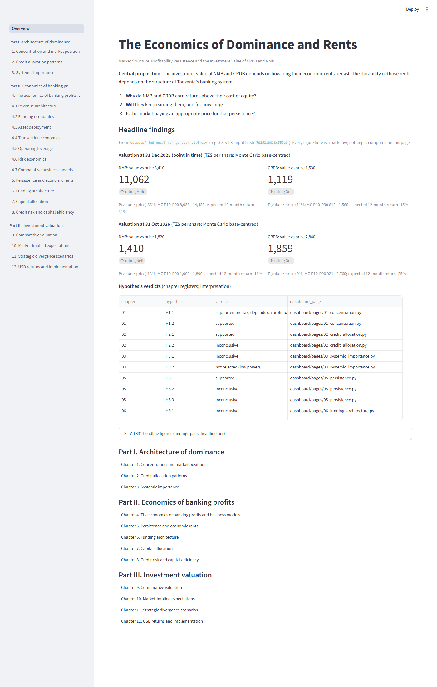
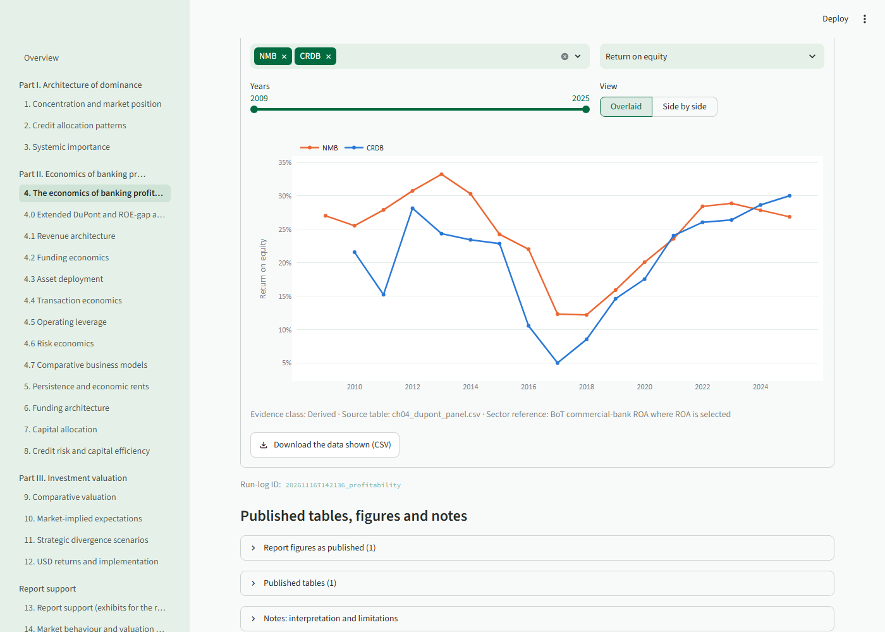
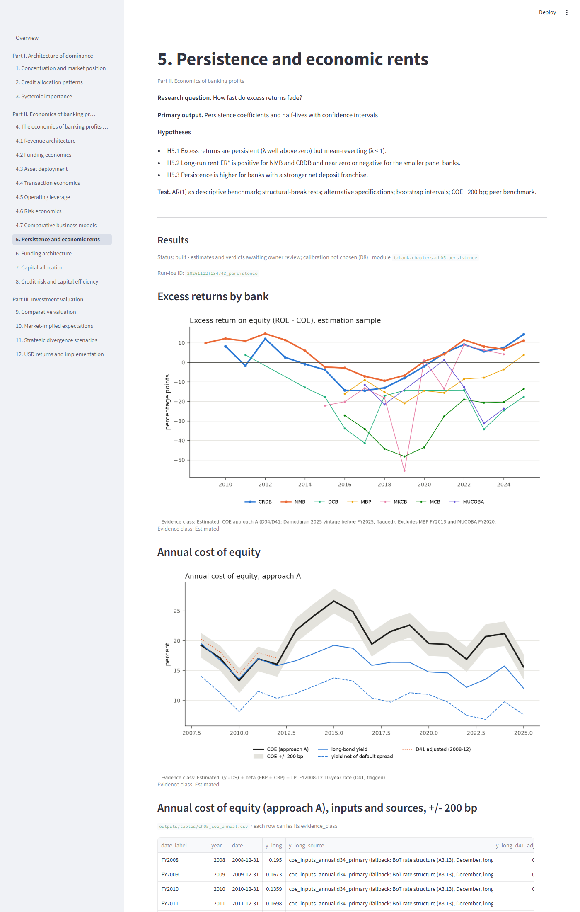
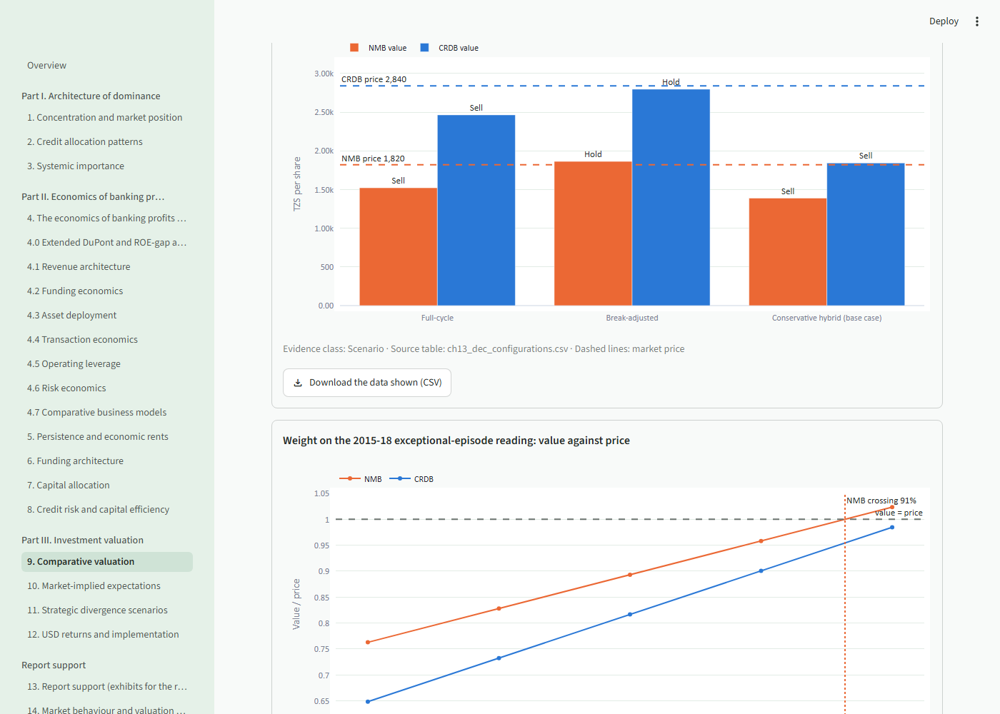
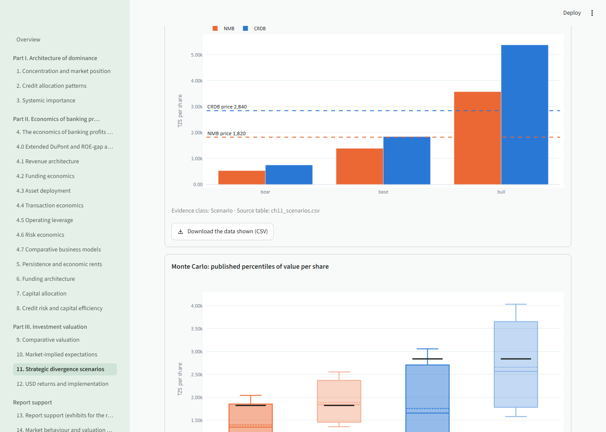
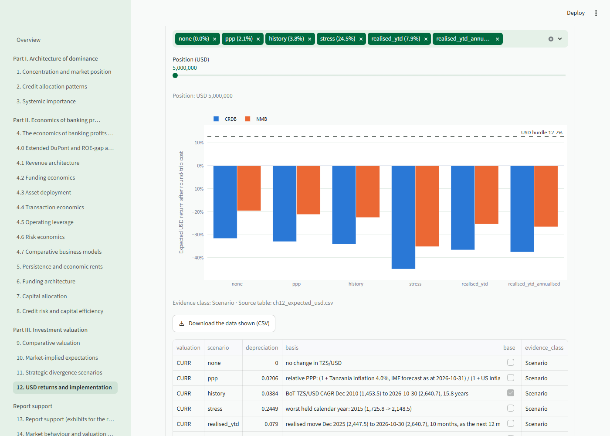
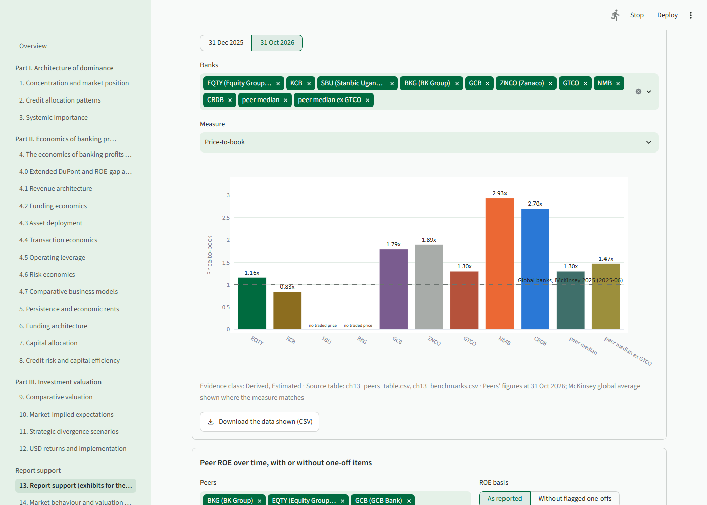
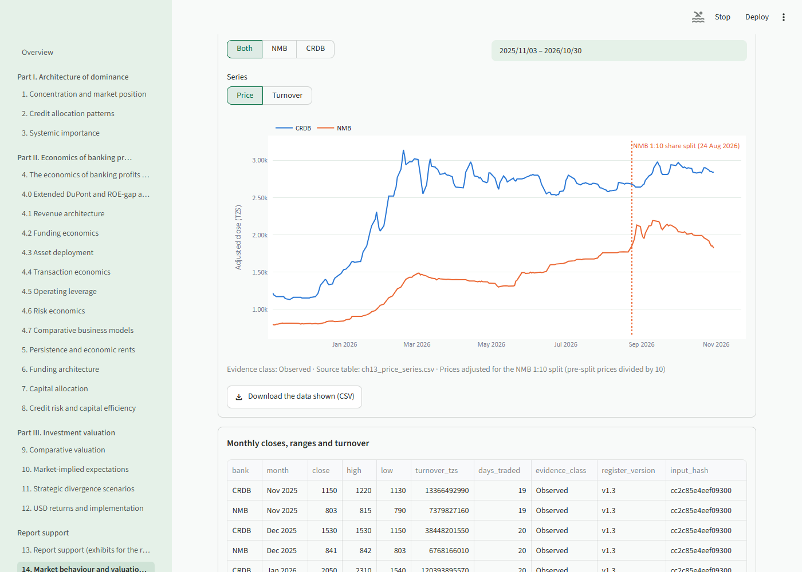

# Dominant Banks, Conditional Rents

*NMB, CRDB and the price of dominance in Tanzania*

Independent research by Jasco John, CPA(T) (ORCID [0009-0007-3630-7943](https://orcid.org/0009-0007-3630-7943)).
Code version 1.1; findings pack v1.17; valuation date 31 October 2026.

| | Link |
| --- | --- |
| Reports (PDF) | [doi.org/10.5281/zenodo.24280749](https://doi.org/10.5281/zenodo.24280749) |
| Code (this repository; concept DOI, all versions) | [doi.org/10.5281/zenodo.24280124](https://doi.org/10.5281/zenodo.24280124) |
| Data | [doi.org/10.5281/zenodo.24280285](https://doi.org/10.5281/zenodo.24280285) |
| Dashboard | [tanzania-banking-rents.streamlit.app](https://tanzania-banking-rents.streamlit.app/) |

## What this is

NMB Bank and CRDB Bank hold about half of Tanzania's banking assets and most of the domestic market value of the Dar
es Salaam Stock Exchange (DSE). This project keeps three questions apart:

- **why** the two banks earn returns above their cost of equity;
- **whether** they will keep earning them, and for how long;
- **whether** the share prices pay a fair price for that persistence.

The work has three parts, each with a chapter range:

- **Part I, the architecture of dominance:** chapters 1-3, market structure.
- **Part II, the economics of banking profits:** chapters 4-8, profitability, persistence, funding, capital and
  credit risk.
- **Part III, investment valuation:** chapters 9-14, value, market-implied persistence, scenarios, USD returns, market
  evidence: peers, analyst views, price formation and liquidity.

The hypotheses were set before the analysis was run ([`docs/RESEARCH_HYPOTHESES.md`](docs/RESEARCH_HYPOTHESES.md)).
The valuation method is in [`docs/VALUATION_SPEC.md`](docs/VALUATION_SPEC.md).

This repository holds:

1. the pipeline that rebuilds every table, figure and verdict;
2. the final dataset;
3. the dashboard;
4. the documentation needed to reproduce the work.

## The four reports

- **Dominant Banks, Conditional Rents** (main report). NMB and CRDB are central and highly profitable: on a group
  basis, 51.4% of banking assets and 65.2% of sector pre-tax profit in 2025. But their rents depend on the credit
  cycle and on policy, and today's prices already pay for more than the record supports.
- **NMB Bank Plc, company report: Sell.** The stronger franchise, already priced for a rent that must last. Value
  TZS 1,388 against a price of TZS 1,820; expected 12-month return −12.7%.
- **CRDB Bank Plc, company report: Sell.** A leveraged growth franchise, priced for a rent it has not yet proved.
  Value TZS 1,842 against a price of TZS 2,840; expected 12-month return −25.7%.
- **Tanzanian Bank Equities for Foreign Investors, investor note.** Not investable at today's prices for a dollar
  investor: the expected 12-month USD return is −16.1% for NMB and −28.5% for CRDB (at 3.8% a year depreciation),
  against a USD hurdle of 12.7%.

The report PDFs are on Zenodo ([10.5281/zenodo.24280749](https://doi.org/10.5281/zenodo.24280749)). Every figure
in them is a row of the findings pack
[`outputs/findings/findings_pack_v1.17.csv`](outputs/findings/findings_pack_v1.17.csv), which is also what the
dashboard shows.

## Reproduce

Python 3.11 or later, with the dependencies pinned in [`requirements.txt`](requirements.txt). **Tested on Python
3.14:** the release checks (clean install, tests, a full rebuild and the dashboard) ran on 3.14 with the pinned
versions. Python 3.11 is the minimum the package declares, but it has not yet been tested.

**System dependency for OCR: Tesseract.** Some scanned quarterly statements have no usable text layer. Their text
copies in `data/ocr/` are rebuilt with `python -m tzbank.extract.ocr`, which needs
[Tesseract OCR](https://github.com/tesseract-ocr/tesseract) 5.x with the `eng` and `osd` language data on the `PATH`.
On Windows, set `TZBANK_TESSERACT` to the folder holding `tesseract.exe` if it is not on the `PATH`. OCRmyPDF is
installed from `requirements.txt`; Ghostscript and Poppler are not needed. Everything else runs without Tesseract.

```bash
python -m venv .venv
source .venv/bin/activate            # Windows PowerShell: .venv\Scripts\Activate.ps1
pip install -r requirements.txt
pip install -e .
python -m pytest                     # without the raw files, tests that need them skip with a message
```

**Rebuild everything.** The repository holds the owner-compiled inputs: the valuation inputs workbook, the Phase 1
bank panel, the BoT research databases, the manual entries and MANIFEST. It does not hold the third-party raw files:
- bank reports;
- BoT, IMF and World Bank documents;
- DSE site snapshots;
- broker and peer-bank reports;
- FinScope microdata.

To rebuild:

1. **Fetch the raw files.** [`docs/DATA_REQUIREMENTS.md`](docs/DATA_REQUIREMENTS.md), section "Raw files to fetch",
   says what to fetch, from where and where to put it. [`docs/SOURCE_REGISTER.md`](docs/SOURCE_REGISTER.md) gives
   every document's URL, and [`data/raw/MANIFEST.csv`](data/raw/MANIFEST.csv) gives every file's sha256.
2. **Check the files:** `python -m tzbank info`. Every file should match its MANIFEST hash.
3. **Run the pipeline:** `python -m tzbank run all`. It takes about an hour on a laptop and rewrites `outputs/`.
   Each stage also runs alone (`python -m tzbank run <stage>`), and each run writes a run log with the git commit,
   the input hashes and the configuration.
4. **Compare:** `git diff --stat outputs/findings/ outputs/tables/ outputs/valuation/` shows whether the findings
   pack and the dataset were reproduced. In the release test (a clean clone, with the raw files placed as
   DATA_REQUIREMENTS describes), all three were reproduced byte for byte.

**Two things a rebuild does not reproduce exactly:**

- **DSE site snapshots.** The DSE data library (`data/raw/dse/`) is built from snapshots of the exchange's public
  website (`python -m tzbank.ingest.dse_library fetch`). The snapshots used here are not redistributed. A new fetch
  gives a library as of the day you fetch it, with new hashes, so its MANIFEST rows will not match. Chapters 13 and
  14 read the library. Their datasets stop at the cut-off in `config/settings.yaml` (`library.cutoff`, 30 October
  2026), so a later fetch should give the same rows unless the exchange has revised its history; any difference
  shows in those chapters' tables and findings.
- **Regenerated documents.** The pipeline also rewrites the chapter notes and manifests (`outputs/notes/`,
  `outputs/manifests/`) and two documents (`docs/SOURCE_REGISTER.md`, `docs/VARIABLE_DICTIONARY.md`). The published
  copies of these files were cleaned for release, with internal task references removed, so after a rebuild git shows
  them as modified. The changes are in wording only: no number or verdict changes. Run logs also differ by
  timestamp.

The point-in-time rules in [`docs/PUBLICATION_DATE_RULES.md`](docs/PUBLICATION_DATE_RULES.md) decide which data
counted as public at each valuation date.

## Data

The final dataset is in this repository and, as the same files, in the Zenodo dataset record
([10.5281/zenodo.24280285](https://doi.org/10.5281/zenodo.24280285)).
It contains:

- the derived tables in `outputs/tables/` and `outputs/valuation/`;
- the findings pack;
- `data/raw/MANIFEST.csv`;
- [`DATA_README.md`](DATA_README.md).

Every table carries an `evidence_class` column (Observed, Derived, Estimated, Scenario or Interpretation). Units:
- money is in full TZS;
- ratios are decimals;
- per-share values are as reported; NMB's 1:10 split, effective 24 August 2026, is applied in code.

Further references:
- variables: [`docs/VARIABLE_DICTIONARY.md`](docs/VARIABLE_DICTIONARY.md) and
  [`docs/DEFINITIONS.md`](docs/DEFINITIONS.md);
- methods: [`docs/EMPIRICAL_METHODOLOGY.md`](docs/EMPIRICAL_METHODOLOGY.md);
- evidence classes and limitations: [`docs/EVIDENCE_AND_LIMITATIONS.md`](docs/EVIDENCE_AND_LIMITATIONS.md);
- decisions: [`docs/DECISION_LOG.md`](docs/DECISION_LOG.md), the method decisions D1-D97 that tables and documents
  cite by id.

| Source | Used for |
| --- | --- |
| NMB and CRDB audited annual reports and BoT-format quarterly statements | Financials, capital, interims |
| Seven-bank Phase 1 panel (owner-compiled) | Peer financials FY2008-FY2025 |
| Bank of Tanzania reports and statistics | Sector totals, rates, credit by activity, payments |
| Dar es Salaam Stock Exchange daily reports and filings | Prices, turnover, corporate actions |
| IMF, World Bank, Moody's | Macro context, stress tests |
| Broker notes and peer-bank reports | Analyst comparison, African peers |
| FinScope Tanzania (FSD Tanzania) | Financial inclusion profile |

**DSE daily trading data:** source Dar es Salaam Stock Exchange; included for non-commercial research reproducibility; remains subject to the DSE’s own terms and is not covered by this project’s CC BY 4.0 licence. It is in `data/raw/NMB_CRDB_52wk_and_trading_value.xlsx` and the
"Daily Market Data" sheet of `data/raw/NMB_CRDB_Valuation_Inputs.xlsx` (NMB and CRDB, 21 Aug 2025 – 5 Nov 2026).

## Dashboard

```bash
streamlit run dashboard/app.py
```

The dashboard reads the committed outputs and computes nothing. It has a landing page, chapters 1-14 and chapter 4
subpages 4.0-4.7. Each page shows:
- the research question and hypotheses;
- the results, with their evidence classes;
- the limitations;
- the run-log ID of what it displays.

The dashboard is interactive (v1.0). It selects, filters and re-plots the published tables; it computes no new
estimate, and every number on screen is a value in `outputs/tables/`, `outputs/valuation/` or the findings pack.

- **Choose and compare (every chapter page).** Pick NMB, CRDB or both; a year range (or date range for market
  data); a measure where a chapter has several (ROE, ROA, NIM, cost-to-income, cost of risk, NPL ratio, capital
  ratios, loan-to-deposit and others). Charts are Plotly (hover values, zoom, legend toggling) in the house colours
  (NMB orange, CRDB blue) and carry their evidence class and source table. Every chart and table has a
  "Download the data shown (CSV)" button that writes exactly what is drawn.
- **Other banks.** On the profitability, cost, funding, credit and capital pages, add any of the seven listed
  Tanzanian banks (FY2006-2025 where reported), with the BoT sector ROA and the smaller banks' median deposit cost
  as reference lines where published. On the valuation and peer pages, compare seven African listed banks on P/B,
  P/E, ROE, cost of equity, justified P/B, capital and NPL ratios at either valuation date, with the McKinsey global
  averages (ROE, P/B) as reference lines; banks without a traded price are labelled so, and GCB's and GTCO's
  one-off years are marked, with a toggle for ROE with or without them.
- **Richer pages.** Valuation (the three cases, the weight on the 2015-18 reading and the crossing weights, the
  rating map, sensitivity grids, P/B and P/E history); market-implied iso-value surface and value bridge; scenarios,
  Monte Carlo percentiles and the assumption tornado; USD returns by depreciation case; DSE prices and turnover with
  the NMB split marked, liquidity and microstructure; analyst targets and this study's values against the price, by
  broker; the quarterly statements by bank and measure.
- Every page keeps its research question, hypotheses, evidence classes, limitations and run-log ID; the report
  figures as published and every chapter table remain available (with downloads) under each page.

Public URL: <https://tanzania-banking-rents.streamlit.app/>. To deploy your own copy on Streamlit Community Cloud,
use entry file `dashboard/app.py`; the requirements are in `dashboard/requirements.txt` and the theme in
`.streamlit/config.toml`. No secrets are needed.

| Landing page | Chapter 4: profitability, listed banks |
| --- | --- |
|  |  |
| **Chapter 5: persistence** | **Chapter 9: valuation cases** |
|  |  |
| **Chapter 11: Monte Carlo percentiles** | **Chapter 12: USD returns** |
|  |  |
| **African peers** | **DSE market data** |
|  |  |

## Excel model (no Python needed)

`Tanzania_Banking_Rents_Model.xlsx` is a chapter-organised Excel companion to the pipeline: open it in Excel (2019 or
later) or LibreOffice, change a blue input cell and the chapters, the engine runs and the Summary recalculate.
**Download:** [Tanzania_Banking_Rents_Model.xlsx](https://github.com/JascoJohn/tanzania-banking-rents/releases/latest/download/Tanzania_Banking_Rents_Model.xlsx)
(an asset of each GitHub release; written by `python -m tzbank run excel_model` to `outputs/valuation/`). No macros,
no external links. The Summary shows each live value beside the published figure and their difference, and flags
whether every engine run converged; every report figure is on its chapter sheet.

- **Sheets:** README, Summary (value per share, target, rating and the bridge for both dates), Inputs (every
  assumption, the point-in-time case inputs per date and bank, the full assumption register for base, bear and
  bull, with named ranges), the NMB and CRDB data panel, chapters 1-14, and one engine sheet per bank, date and
  scenario.
- **Live (formulas):** ratios, the DuPont tree, cost of equity, excess returns, the deposit franchise, capital
  headroom and payout, cost of risk and return on RWA, the driver-based forecast engine (fixed-point solve and the
  base-case growth cap), RIM / DDM / justified P/B, payout path, sensitivity grids, implied ER*, lambda, COE and
  ROE*, iso-value surfaces, the five-step bridge and rerating, scenarios, USD returns and breakeven depreciation.
- **Static (grey, computed in Python):** persistence regressions and break tests, interval coverage, bootstraps,
  the Monte Carlo, beta estimation, the NIM x cost-of-risk grid (81 full engine runs per bank and date), liquidity
  and capacity from daily trading data, and chapters 13-14. Each block names its script and source table.
- **Python is the source of truth.** Every build recalculates the workbook and compares each live cell with the
  Python table (`outputs/valuation/excel_model_check.csv`: item, python, excel, diff, pass; tolerance 0.01% or
  TZS 0.01 per share); the step fails on any difference or any formula error.

## How to cite

John, J. (2026). *Dominant Banks, Conditional Rents: NMB, CRDB and the price of dominance in Tanzania*. Independent
research report, 31 October 2026. https://doi.org/10.5281/zenodo.24280749

- **Code:** John, J. (2026). *Dominant Banks, Conditional Rents* (code; concept DOI, all versions).
  https://doi.org/10.5281/zenodo.24280124
- **Data:** John, J. (2026). *Dominant Banks, Conditional Rents: dataset*.
  https://doi.org/10.5281/zenodo.24280285
- **Machine-readable:** [`CITATION.cff`](CITATION.cff).

## Licences

- **Code:** MIT ([`LICENSE`](LICENSE)).
- **Data, tables, documentation and reports:** CC BY 4.0 ([`LICENSE-DATA.md`](LICENSE-DATA.md)).
- **Third-party sources** keep their own terms and are not redistributed.

## Disclaimer

This is independent, non-commercial research. It is **not investment advice** and not a recommendation to buy or sell
any security.

- **Ratings.** The ratings (Buy, Hold, Sell) come from a stated rule applied to a model and its assumptions at the
  valuation date. They change as prices, data and assumptions change.
- **No payment, no client.** No fee, commission or other consideration was received for this work, and it was not
  prepared for any client.
- **No holdings.** The author holds no shares in NMB or CRDB.

Check figures against the cited sources before relying on them.

## Contact

Jasco John, CPA(T): jasco.john98@gmail.com · ORCID 0009-0007-3630-7943. Corrections are welcome through the
repository's issues.
